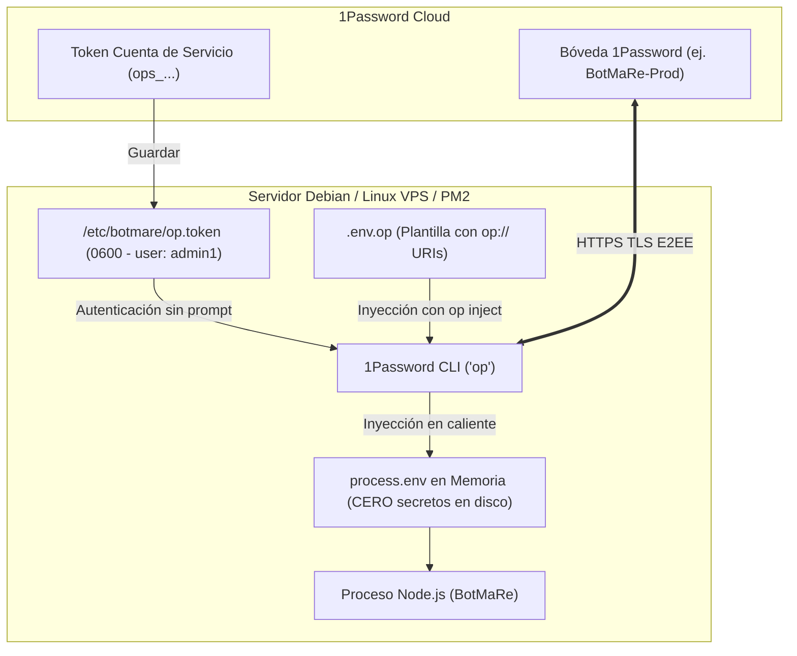

<div align="center">
  
  <h1>🦊 BotMaRe - Dashboard</h1>
  <p><strong>La plataforma definitiva de automatización para WhatsApp impulsada por Inteligencia Artificial, Orquestación Multi-Proveedor y Despliegue Multi-Plataforma.</strong></p>

  <p>
    
    
    
    
    
    
    
  </p>
  <p>
    <i>Automatiza, difunde y responde como un humano 24/7 en Android, Linux, Windows y la Nube.</i>
  </p>
</div>

<br />

> **BotMaRe (powered by Kitsune Engine)** transforma tu cuenta de WhatsApp en una central de operaciones inteligente. Integra modelos de IA, flujos de automatización, programadores de recordatorios, sincronización con Google Sheets, asistente maestro por Telegram y un panel de administración premium (_Glassmorphism_), todo en un monolito de alto rendimiento.

---

<details open>
<summary><h2>📑 Tabla de Contenidos</h2></summary>

1. [✨ Características Principales](#-características-principales)
2. [🚀 Despliegue Multi-Plataforma](#-despliegue-multi-plataforma)
   - [📱 Android (Termux)](#-1-android-termux)
   - [🐧 Linux / Debian / VPS](#-2-linux--debian--ubuntu-vps)
   - [🪟 Windows Local](#-3-windows-local)
   - [☁️ Despliegue en la Nube con Terraform](#-4-despliegue-en-la-nube-con-terraform)
   - [🐳 Docker / Docker Compose](#-5-docker--docker-compose)
   - [🔐 Gestión de Secretos y API Keys (1Password / .env)](#-6-configuración-de-seguridad-y-gestión-de-secretos-env--1password)
3. [🔄 Centro de Actualizaciones](#-centro-de-actualizaciones)
4. [📄 Inteligencia Artificial Multimodal, Documentos y OCR](#-inteligencia-artificial-multimodal-documentos-y-ocr)
   - [📑 Extracción y Lectura de Documentos (PDF, Excel, Word, TXT)](#-extracción-y-lectura-de-documentos-pdf-excel-word-txt)
   - [👁️ Visión Multimodal y OCR (Imagen a Texto)](#-visión-multimodal-y-ocr-imagen-a-texto)
   - [🎙️ Transcripción de Audio y Notas de Voz](#-transcripción-de-audio-y-notas-de-voz-whisper)
   - [🧠 Cerebro de IA y Auto-Respuestas Contextuales](#-cerebro-de-ia-y-auto-respuestas-contextuales)
5. [📘 Manual de Usuario (Web & Telegram)](#-manual-de-usuario)
   - [🦊 Asistente Maestro de Telegram](#-asistente-maestro-de-telegram)
   - [🤖 Carga Masiva y Spintax](#-difusiones-masivas-y-spintax)
   - [🧠 Variables Dinámicas y Cerebro IA](#-variables-dinámicas-y-cerebro-ia)
   - [🎙️ Macros Multimedia](#-macros-multimedia)
6. [🧹 Mantenimiento Autónomo y Memoria](#-mantenimiento-autónomo-y-limpieza)
7. [🛠️ Gestión Avanzada con PM2](#-gestión-avanzada-con-pm2)
8. [⚠️ Troubleshooting](#-solución-a-errores-comunes)
9. [🔄 Historial de Actualizaciones (Changelog)](#-historial-de-actualizaciones-changelog)

</details>

---

## ✨ Características Principales

| Característica | Descripción |
| :--- | :--- |
| 🧠 **IA Multi-Proveedor (11 IAs)** | Groq, Cerebras, SambaNova, SiliconFlow (DeepSeek V3/R1), Mistral, Together, Gemini 2.5, DeepSeek, OpenRouter, Nvidia NIM y OpenAI con Failover automático. |
| 🔐 **Gestor de Secretos Multi-Proveedor** | Soporte opcional para **1Password Secrets Manager** (`op inject` en memoria), variables del sistema (`environment`) y `.env` tradicional (`dotenv`). Tolerancia cero a fallback silencioso, token seguro en Debian/PM2 y asistente CLI interactivo. |
| 🛡️ **Blindaje Criptográfico Signal / Baileys** | Transporte E2EE con resolución segura de reintentos (`getMessage`), eliminando bloqueos de *"Esperando mensaje"* y protegiendo la conexión durante reconexiones en caliente. |
| ⚡ **Diagnóstico de IAs Live** | Pruebas de latencia y estado desde consola (`pnpm test:llm`), Telegram (`/diagnostico`) y Web (`⚡ Probar Conexiones IA`). |
| 📄 **IA Multimodal, Documentos y OCR** | Extracción nativa de PDF, Excel (XLSX), Word (DOCX) y TXT, visión artificial (OCR imagen a texto) y transcripción de notas de voz con Whisper. |
| 📊 **Sincronización Google Sheets** | Actualización automática periódica (15m, 1h, 12h o manual) de auto-respuestas y plantillas desde hojas de cálculo de Google. |
| 📱 **WhatsApp Agent** | Comprensión de imágenes (Visión), transcripción de notas de voz (Whisper), documentos y QR/Pairing Code instantáneo. |
| 🦊 **Asistente Telegram** | Control remoto total por comandos (`/diagnostico`, `/actualizar`, `/backup`, `/start`) y botones interactivos. |
| 📢 **Difusión con Spintax** | Campañas masivas anti-spam con variación de frases y macros de contacto dinámicas. |
| 📅 **Recordatorios Inteligentes** | Programación individual y grupal con frecuencias configurables y verificación de conexión activa. |
| 🛡️ **Blindaje Anti-Ban** | Retardos progresivos, pausas y simulación humana ("Escribiendo...", "Grabando audio..."). |
| 🗄️ **Persistencia Desacoplada** | Arquitectura multi-driver mediante `IDatabaseAdapter` con soporte intercambiable para LowDB (JSON), MongoDB Atlas y SQLite WAL, erradicando E/S bloqueante en CRM y telemetría. |
| 🔒 **Hardening Integral de Seguridad** | Autenticación timing-safe en webhooks (`crypto.timingSafeEqual`), cifrado AES-256-GCM para respaldos, rate limiting con bloqueo por fuerza bruta y blindaje SSRF con DNS estricto. |
| 🐳 **Docker Multi-Stage No-Root** | Contenedor productivo ultra-ligero basado en `node:20-alpine` bajo usuario no privilegiado `node`, sin compiladores C++ y con healthcheck en `/healthz`. |
| 🧪 **Suite de 208 Tests Automatizados** | 25 suites de pruebas unitarias, de integración real y de contrato bajo Vitest, y cero errores de compilación TypeScript. |
| ☁️ **Infraestructura como Código** | Archivos `main.tf` listos para aprovisionar VPS en AWS, Hetzner, DigitalOcean u Oracle Cloud. |

---

## 🚀 Despliegue Multi-Plataforma

### 📱 1. Android (Termux)
Ideal para ejecutar el bot de forma continua en tu teléfono Android sin root.

**Opción A: Instalador automático en 1 paso:**
```bash
curl -fsSL https://raw.githubusercontent.com/LedezmaSune/BotMaRe/main/install-termux.sh | bash

# Iniciar el panel maestro:
cd BotMaRe && pnpm run menu
```

**Opción B: Instalación manual en Termux:**
```bash
# 1. Dependencias del sistema y herramientas de compilación
pkg update -y && pkg install -y git nodejs-lts sqlite clang make python

# 2. Instalar gestores y clonar repositorio
npm install -g pnpm@latest node-gyp
git clone https://github.com/LedezmaSune/BotMaRe.git
cd BotMaRe

# 3. Iniciar, compilar y actualizar todo en 1 solo paso automático:
bash termux.sh

# (O si prefieres el menú interactivo con todas las opciones):
pnpm run menu

# (O si tienes datos móviles lentos/inestables, abre el Gestor Visual Web):
pnpm run install:web
# Abre en el navegador de tu celular: http://localhost:8000
```

> [!TIP]
> **Lanzador Rápido Todo-en-Uno (`termux.sh`):** Sincroniza los últimos cambios de GitHub (`git pull`), asegura las dependencias de Node.js, auto-descomprime el Dashboard en 0.2s, compila `better-sqlite3` automáticamente con Clang si hace falta e inicia BotMaRe en un único comando.
>
> **Gestor de Descargas Visual Web (`pnpm run install:web`):** Si tu conexión móvil se corta o descarga a baja velocidad (~40 KiB/s), este asistente nativo sin dependencias te permite pausar, reanudar y ver en vivo el avance porcentual y los logs desde el navegador de tu teléfono (`http://localhost:8000`).

---

### 🐧 2. Linux / Debian / Ubuntu VPS
Para servidores dedicados o VPS en la nube.
```bash
# Instalador desatendido en Linux:
curl -fsSL https://raw.githubusercontent.com/LedezmaSune/BotMaRe/main/install.sh | bash

# Iniciar servidor:
cd BotMaRe && ./start.sh
```

---

### 🪟 3. Windows Local
Sin necesidad de permisos de Administrador.
1. Descarga el repositorio o haz `git clone https://github.com/LedezmaSune/BotMaRe.git`.
2. Dale doble clic a `install-windows.bat` para instalar dependencias y base de datos.
3. Dale doble clic a `START.bat` para abrir el **Menú de Control Maestro**.
4. O ejecuta directamente `npm run dev` para modo desarrollo.

---

### ☁️ 4. Despliegue en la Nube con Terraform
Aprovisiona en minutos un servidor VPS con disco SSD cifrado, IP pública fija, Docker y BotMaRe preconfigurado.
```bash
# 1. Configurar variables (opcional):
cp terraform.tfvars.example terraform.tfvars

# 2. Inicializar Terraform:
terraform init

# 3. Aplicar y desplegar servidor:
terraform apply
```

---

### 🐳 5. Docker / Docker Compose

La imagen Docker utiliza una arquitectura multi-etapa (*multi-stage build*):
- **Builder**: Compila la exportación estática de Next.js (`out/`) e instala dependencias completas.
- **Prod-Deps**: Prepara `node_modules` únicamente con dependencias de producción.
- **Runner**: Basado en `node:20-alpine` sin compiladores de C/C++ ni herramientas de desarrollo (eliminando superficie de ataque). Se ejecuta bajo el usuario no privilegiado `USER node`, incluye comprobación de salud periódica `HEALTHCHECK` sobre `/healthz` y empaca los 16 plugins oficiales en `data/plugins/`.
- **Runtime en Producción**: Ejecuta el servidor Node mediante `tsx` (incluido como dependencia de producción en `dependencies`), garantizando compatibilidad inmediata con la carga dinámica de plugins en TypeScript.

```bash
# Iniciar contenedor en segundo plano:
docker compose up -d --build

# Ver logs en tiempo real:
docker compose logs -f

# Comprobar estado y salud del contenedor:
curl -f http://localhost:8000/healthz
```

---

### 🔐 6. Configuración de Seguridad y Secretos (.env / 1Password)

BotMaRe implementa **validación estricta al arranque** antes de levantar cualquier servicio (Dashboard, WhatsApp, Telegram o Base de Datos). El sistema exige **5 variables de seguridad obligatorias**:

| Variable | Propósito | Regla de Validación |
| :--- | :--- | :--- |
| `DASHBOARD_USER` | Usuario administrador para la interfaz web. | No puede estar vacío. |
| `DASHBOARD_PASS` | Contraseña de acceso al Dashboard web. | No puede estar vacía, contener `CAMBIA_ESTO`, ni ser `tu_contrasena_segura` o `admin123`. |
| `WEBHOOK_API_KEY` | Clave API para webhooks entrantes (Make, Zapier, Google Sheets). | No puede estar vacía ni contener `CAMBIA_ESTO`. |
| `SUPERADMIN_KEY` | Clave maestra para el Panel SuperAdmin y gestión de licencias (`Ctrl+Shift+S`). | No puede estar vacía ni contener `CAMBIA_ESTO`. |
| `BACKUP_ENCRYPTION_KEY` | Clave simétrica de 256 bits para cifrado de respaldos locales y enviados a Telegram. | No puede estar vacía ni contener `CAMBIA_ESTO`. |

#### 🛡️ Gestión Integral de Secretos y API Keys (1Password / .env / environment)

BotMaRe implementa una arquitectura de seguridad corporativa (**DevSecOps**) administrada por `SecretProviderManager` para proteger todas tus API Keys (OpenAI, Gemini, Groq, DeepSeek, Nvidia, etc.) y credenciales criptográficas críticas:



---

##### 🔑 ¿Por qué es fundamental proteger tus API Keys en Producción?
BotMaRe orquesta hasta **11 proveedores de Inteligencia Artificial** simultáneamente. Si almacenas estas claves en texto plano dentro de un archivo `.env` en tu servidor:
1. Un descuido en un commit de Git puede exponer tus claves públicamente en internet.
2. Si el servidor sufre una brecha de acceso, cualquier atacante que lea el disco obtendría tus créditos y datos confidenciales.
3. Al utilizar **1Password Secrets Manager**, el archivo `.env` físico se reemplaza por `.env.op` conteniendo únicamente referencias opacas (`op://...`). **Las claves reales existen únicamente en la memoria RAM durante el tiempo de ejecución.**

---

##### ⚙️ Los Tres Proveedores de Secretos Soportados

| Proveedor | Identificador | Características Principales | Ideal Para |
| :--- | :--- | :--- | :--- |
| **1Password CLI** | `1password` | Inyección segura en memoria vía `op inject`. Cero secretos en disco, rotación en caliente sin tocar el servidor, tolerancia cero a fallbacks silenciosos. | **Producción VPS / Debian / Nube** |
| **Variables de Sistema** | `environment` | Lee directamente de `process.env` inyectadas por el orquestador sin depender de ningún archivo local. | **Docker, Kubernetes, CI/CD** |
| **Dotenv Clásico** | `dotenv` | Lectura tradicional desde archivo plano local `.env`. | **Desarrollo local rápido y Termux** |

> [!IMPORTANT]
> **Tolerancia Cero a Fallbacks Silenciosos:** Si configuras `BOTMARE_SECRET_PROVIDER=1password` y la CLI de 1Password o el token de servicio no responden, el servidor aborta el arranque de inmediato con un código de salida `process.exit(1)`. **Bajo ninguna circunstancia recurre silenciosamente a un archivo .env residual**, protegiendo contra el uso inadvertido de claves desactualizadas o comprometidas.

---

##### 📁 Estructura Recomendada de Ítems en la Bóveda de 1Password

Cuando BotMaRe migra o se conecta a tu bóveda (por defecto **`BotMaRe-Prod`**), organiza las claves en **Notas Seguras** temáticas:

| Ítem en 1Password | Campos / Variables Mapeadas | Formato de Referencia `op://` |
| :--- | :--- | :--- |
| **`botmare-ai`** | `groq_api_key`, `gemini_api_key`, `openai_api_key`, `deepseek_api_key`, `nvidia_api_key`, `openrouter_api_key`, `mistral_api_key`, `together_api_key`, `cerebras_api_key`, `sambanova_api_key`, `siliconflow_api_key`, `cheaperinference_api_key` | `op://BotMaRe-Prod/botmare-ai/openai_api_key` |
| **`botmare-security`** | `superadmin_key`, `webhook_key`, `backup_key`, `jwt_secret`, `session_secret` | `op://BotMaRe-Prod/botmare-security/superadmin_key` |
| **`botmare-dashboard`** | `password` | `op://BotMaRe-Prod/botmare-dashboard/password` |
| **`botmare-telegram`** | `bot_token` | `op://BotMaRe-Prod/botmare-telegram/bot_token` |

---

##### 🚀 Asistente de Migración Automática (Web Dashboard & CLI)

Tienes dos opciones para migrar automáticamente todas tus variables actuales de `.env` hacia 1Password sin editar archivos a mano:

###### Opción A: Desde el Panel Web (Recomendado)
1. Abre tu panel en **`https://tu-dominio/settings`** y localiza la tarjeta **"Proveedor de Secretos & 1Password"**.
2. Observarás los semáforos de diagnóstico en vivo:
   - **CLI 1PASSWORD:** `🟢 Instalada y lista`
   - **PLANTILLA .ENV.OP:** `🟢 Configurada`
   - **SERVICE ACCOUNT TOKEN:** `🟢 Activo`
   - **VARIABLES EN .ENV:** `🔵 55 detectadas`
3. Escribe el nombre de tu bóveda (ej. `BotMaRe-Prod`).
4. Deja marcadas las casillas:
   - `[X] Crear notas/items automáticamente en 1Password`
   - `[X] Activar 1Password como proveedor principal tras la migración`
5. Haz clic en **`🚀 Ejecutar Migración Ahora`**.
6. **¿Qué hace BotMaRe internamente?**
   - Respalda tu archivo actual con timestamp (`.env.backup.2026-...`).
   - Mapea cada API Key sensible a su URI segura `op://`.
   - Genera la plantilla de producción `.env.op`.
   - Crea automáticamente la bóveda en 1Password si aún no existe.
   - Sube todas las notas y secretos a tu cuenta de 1Password usando `op item create`.
   - Deja activo `1password` como proveedor principal.

###### Opción B: Desde la Consola (CLI Asistente)
```bash
pnpm run setup:provider
# O desde el menú maestro:
npm run menu # Selecciona la opción [19] 🔐 Proveedor Secretos
```
Elige la opción **`[3] 🔄 Migrar variables actuales de .env a 1Password`** y el asistente realizará todo el flujo por consola.

---

##### 🐧 Despliegue en Producción (Debian / Ubuntu / VPS con PM2)

En servidores remotos sin interfaz gráfica, 1Password se autentica de forma no interactiva mediante una **Cuenta de Servicio (Service Account)**.

###### 1. Crear la Cuenta de Servicio en 1Password:
1. En tu consola web de 1Password (ej. `my.1password.com`), dirígete a **Herramientas de desarrollo** -> **Cuentas de servicio**.
2. Haz clic en **Nueva cuenta de servicio** y nómbrala `BotMaRe-Prod`.
3. Marca la casilla **Autorización para crear bóvedas**.
4. Haz clic en **Generar token**. 1Password te entregará un token que inicia con **`ops_...`**. Cópialo.

###### 2. Guardar el Token en Debian con los Permisos Correctos:
En tu terminal de Debian, guarda el token en la ruta del sistema asignándole como propietario al usuario que ejecuta PM2 (por ejemplo, `admin1`):

```bash
sudo mkdir -p /etc/botmare
echo "ops_TU_TOKEN_AQUI" | sudo tee /etc/botmare/op.token > /dev/null

# CRÍTICO: Asignar permisos al usuario de PM2 para que Node.js pueda leerlo
sudo chown admin1:admin1 /etc/botmare/op.token
sudo chmod 600 /etc/botmare/op.token
```

###### 3. Iniciar o Reiniciar PM2:
```bash
cd ~/BotMaRe
pm2 restart ecosystem.config.js --update-env
```
*`ecosystem.config.js` y el motor `SecretProviderManager` detectan automáticamente el archivo `/etc/botmare/op.token` al arrancar.*

---

##### 🔄 Rotación de API Keys en Tiempo Real (Cero Downtime)

Cuando una API Key de OpenAI, Groq o Gemini caduca, es regenerada o necesita rotarse:
1. **No toques ningún archivo en el servidor.**
2. Abre la app de 1Password en tu celular o navegador.
3. Busca la nota **`botmare-ai`** en la bóveda **`BotMaRe-Prod`** y actualiza el campo correspondiente.
4. Reinicia el proceso con:
   ```bash
   pm2 restart BotMaRe-Unified
   ```
   *(O directamente desde Telegram enviando `/pm2` -> Reiniciar).*
5. BotMaRe levantará de inmediato consumiendo la nueva API Key directamente en memoria RAM.

---

##### 📱 Diagnóstico y Monitorización Remota de Secretos

* **Desde Telegram:** Envía el comando **`/secretos`** o toca el botón **`🔐 Secretos / 1P`** en `/start`. Podrás ejecutar una prueba de inyección en seco (dry-run) y auditar las fuentes de cada variable sin exponer jamás claves en el chat.
* **Desde la Consola:** Ejecuta `pnpm run test:llm` para realizar una prueba de latencia y conectividad real contra cada una de tus API Keys configuradas.
* **Modo Rescate Web:** Si la conexión con 1Password falla temporalmente, `src/server.ts` activa el modo rescate de emergencia para mantener el panel web en línea con una alerta crítica, permitiendo conmutar a `.env` con un solo clic si fuese necesario.

---

#### ⚠️ ¿Por qué se detiene el bot al iniciar o reiniciar?
1. **Otras claves técnicas sin configurar (Causa más frecuente):** Si editas manualmente tu archivo `.env` y asignas tu propia contraseña en `DASHBOARD_PASS`, pero dejas `SUPERADMIN_KEY`, `WEBHOOK_API_KEY` o `BACKUP_ENCRYPTION_KEY` con el texto de ejemplo `CAMBIA_ESTO...`, el validador abortará todo el proceso (`process.exit(1)`). **Al detenerse el servidor por completo, tampoco iniciará el bot de Telegram ni WhatsApp.**
2. **Contraseña en lista negra:** Si en `DASHBOARD_PASS` intentas usar `admin123`, `tu_contrasena_segura` o palabras que incluyan `CAMBIA_ESTO`, el arranque será denegado por considerarse inseguro.

#### 💡 Flujo Recomendado de Configuración Inicial (.env Tradicional)
Para evitar errores de validación y ahorrar tiempo configurando las claves criptográficas si prefieres usar `.env`:

1. **Desde el Menú de Control Maestro (Recomendado):**
   * Presiona la opción **`[17] 🔐 Generar Secretos`** (ejecuta `pnpm run setup:secrets` internamente). Esto autogenerará claves criptográficamente seguras para todas las variables técnicas respetando las que ya tengas configuradas.
   * Si deseas personalizar tu usuario o contraseña web, selecciona después la opción **`[15] 📝 Editar .env`** y cambia únicamente `DASHBOARD_PASS` por la clave personal que prefieras.

2. **Desde la terminal:**
   ```bash
   # 1. Copiar plantilla si aún no tienes .env:
   cp .env.example .env

   # 2. Autogenerar claves y secretos criptográficamente seguros:
   pnpm run setup:secrets
   ```

#### 🔍 ¿Cómo revisar tus credenciales en distintos entornos?
Si necesitas consultar qué usuario y contraseña tienes configurados en tu entorno actual:

* **Windows (PowerShell):** `Get-Content .env | Select-String "DASHBOARD_"`
* **Linux / VPS / Termux (Bash):** `grep -E "DASHBOARD_USER|DASHBOARD_PASS" .env`
* **Docker / Docker Compose:** `docker compose exec botmare env | grep DASHBOARD_`
* **Launcher de BotMaRe:** Opciones `[15]` (ver/editar) o `[17]` (ver estado de generación).

> [!IMPORTANT]
> **Checklist de Producción:** Para la lista de verificación completa de seguridad, aislamiento de red (evitar abrir puerto 8000), rotación de claves y modelo de confianza, consulta [SECURITY.md](./SECURITY.md).

### ⚙️ 7. Precedencia Unificada de Configuración

BotMaRe utiliza una arquitectura de configuración con una única fuente de verdad y precedencia estricta:

1. **Base de Datos (BD / Dashboard / API / `setConfig`)**: Máxima prioridad. Cualquier valor explícito no vacío guardado en la base de datos (Lowdb o MongoDB) sobreescribe los valores de entorno.
2. **Variables de Entorno (`.env` / `process.env`)**: Prioridad media. Definen los valores de infraestructura y arranque inicial cuando la clave no ha sido modificada en la BD.
3. **Valores por Defecto (Defaults en código)**: Prioridad base. Garantizan que el sistema funcione con valores razonables si no están en BD ni en entorno.

> **Caché e Inmutabilidad**: Todas las lecturas (`getConfig`, `getAllConfig`, `getSettings`) están cacheadas en memoria durante 5 minutos para optimizar llamadas concurrentes (ej. cada invocación a LLM). La caché utiliza clonación profunda (`structuredClone`) para garantizar inmutabilidad frente a mutaciones accidentales, y se invalida de forma inmediata ante cualquier actualización (`updateSettings` / `setConfig`).

---

### 📐 8. Estandarización de Fechas y Capa de Dominio

BotMaRe centraliza todas sus entidades en `src/domain/` (`Reminder`, `CRMContact`, `CRMTag`, etc.):

- **Frontera de Persistencia y Transporte**: Todas las marcas de tiempo se representan como cadenas **ISO 8601** (`string`) o milisegundos numéricos en bases de datos (Lowdb/MongoDB), endpoints REST Express y componentes de frontend React.
- **Lógica de Negocio Interna**: Se utilizan instancias `DateTime` (Luxon) o `Date` únicamente durante los cálculos de agendamiento y recurrencia, serializándose a ISO string antes de ser persistidas o transferidas.

---

### 🧪 9. Pruebas y Suite de Contrato (`IDatabaseAdapter`)

BotMaRe incluye pruebas unitarias, de integración y pruebas de contrato para garantizar consistencia entre motores de persistencia:

```bash
# Ejecutar suite de pruebas completa:
pnpm test

# Ejecutar pruebas de contrato contra Lowdb (por defecto):
pnpm test tests/contract

# Ejecutar pruebas de contrato contra MongoDB Atlas o local (requiere base de datos de prueba):
MONGO_URI_TEST="mongodb://localhost:27017/botmare_test" pnpm test tests/contract
```

---

## 💻 Requisitos del Sistema y Modelos Locales (Ollama)

BotMaRe está diseñado para ser extremadamente eficiente y puede ejecutarse en hardware modesto (desde 2 núcleos y 4GB de RAM en local, o VPS económicos de 1 vCPU y 2GB RAM). Si deseas utilizar Inteligencia Artificial sin depender de APIs de pago o internet, puedes conectar BotMaRe con **Ollama** para correr modelos localmente.

### 🏆 Modelos recomendados para equipos básicos y VPS baratos:
Si cuentas con una computadora básica sin tarjeta gráfica dedicada, o estás rentando un servidor en la nube (VPS) muy económico, te recomendamos los siguientes modelos "Ultra Ligeros":

1. **Qwen 2.5 (1.5B o 0.5B)** - *Ideal para respuestas veloces en español sin saturar el CPU.*
   `ollama pull qwen2.5:1.5b`
2. **Llama 3.2 (1B)** - *Excelente seguimiento de instrucciones en un tamaño miniatura.*
   `ollama pull llama3.2:1b`
3. **Gemma 3 (1B) / Gemma 2 (2B)** - *Arquitectura potente de Google, consume aprox. 1.5GB de RAM activa.*
   `ollama pull gemma3:1b`

### 🛠️ ¿Cómo instalar Ollama paso a paso?
Si aún no tienes Ollama en tu computadora o servidor, sigue estos rápidos pasos:

**Para Windows o Mac:**
1. Ve a la página oficial: **[ollama.com/download](https://ollama.com/download)**
2. Descarga el instalador para tu sistema operativo y córrelo (Siguiente, Siguiente...).
3. Abre tu CMD (Símbolo del sistema) o Terminal.
4. Pega el comando del modelo que quieres (ej. `ollama pull qwen2.5:1.5b`) y presiona Enter.

**Para Linux / Ubuntu / VPS:**
1. Abre tu terminal y ejecuta el instalador automático:
   `curl -fsSL https://ollama.com/install.sh | sh`
2. Una vez que termine, instala el modelo que prefieras:
   `ollama pull qwen2.5:1.5b`

### ⚙️ Configuración en BotMaRe:
Una vez que el modelo se haya descargado al 100% en tu terminal con Ollama, solo necesitas actualizar tu archivo `.env`:
```env
OLLAMA_API_URL="http://localhost:11434"
OLLAMA_MODEL="qwen2.5:1.5b" # O el modelo que hayas elegido
```
El motor de IA rotará automáticamente a Ollama en caso de que tus otros proveedores fallen o simplemente como motor principal gratuito.

---

## 🔄 Centro de Actualizaciones

BotMaRe cuenta con un **Centro de Actualizaciones Inteligente** accesible desde 3 canales:

1. **🌐 Desde el Panel Web (Dashboard):**
   - Ve a la pestaña **"Actualizaciones"** para verificar nuevos commits en GitHub.
   - Aplica actualizaciones con un solo clic con respaldo automático preventivo.
2. **🦊 Desde Telegram:**
   - Envía el comando `/actualizar` para buscar nuevas versiones y aplicarlas al instante.
3. **💻 Desde la Terminal (Menú Interactivo):**
   - Ejecuta `pnpm run menu` y selecciona la opción `[10] Git Update`.
4. **⚙️ Actualización Manual (Recomendado para solucionar conflictos):**
   - Si tu entorno es Termux o tienes errores de compilación, ejecuta directamente:
     ```bash
     git pull origin main
     pnpm run build
     ```

---

## 📄 Inteligencia Artificial Multimodal, Documentos y OCR

BotMaRe cuenta con un motor nativo de **Inteligencia Artificial Multimodal** de alto rendimiento diseñado para procesar archivos adjuntos, documentos corporativos, comprobantes y notas de voz directamente desde las conversaciones de WhatsApp sin requerir extensiones externas pesadas.

---

### 📑 Extracción y Lectura de Documentos (PDF, Excel, Word, TXT)
BotMaRe incorpora analizadores especializados (`documentParser`) que leen el contenido de documentos enviados por los usuarios y los convierten en contexto estructurado para el modelo de IA:

| Formato | Extensión | Capacidad de Análisis |
| :--- | :--- | :--- |
| **Adobe PDF** | `.pdf` | Extracción completa de texto estructurado de cotizaciones, contratos, catálogos y manuales. |
| **Microsoft Excel** | `.xlsx`, `.xls` | Conversión de hojas de cálculo, inventarios, listas de precios y balances a texto tabular interpretable por LLMs. |
| **Microsoft Word** | `.docx`, `.doc` | Extracción de párrafos, encabezados y formato de documentos comerciales. |
| **Texto Plano y Datos** | `.txt`, `.csv`, `.json` | Lectura directa de registros, bases de datos exportadas y notas técnicas. |

> **Ejemplo de Uso:** Un cliente envía un archivo PDF con la cotización de un proveedor y pregunta: *"¿Cuál es el monto total del presupuesto y qué servicios incluye?"*. El bot extrae el contenido del PDF, lo analiza con el motor de IA y responde de manera ejecutiva en segundos.

---

### 👁️ Visión Multimodal y OCR (Imagen a Texto)
El agente de WhatsApp comprende imágenes en alta resolución mediante modelos de visión multimodal de última generación (**Gemini 2.5 Flash/Pro**, **OpenAI GPT-4o**, **Groq Llama 3.2 Vision**):

* **Paso de Imagen a Texto (OCR Inteligente):** Transcripción fiel de carteles, capturas de pantalla, notas escritas y comprobantes.
* **Inspección de Comprobantes de Pago:** Detección de número de referencia, monto, banco emisor y fecha para validación de depósitos o transferencias.
* **Identificación Visual de Productos:** El cliente envía una foto de un artículo o repuesto y el bot identifica el producto, consulta su precio o disponibilidad en el inventario y redacta la respuesta adecuada.

---

### 🎙️ Transcripción de Audio y Notas de Voz (Whisper)
Cuando un usuario envía un mensaje de voz en WhatsApp:
1. El motor de audio descarga y normaliza el archivo multimedia.
2. Se procesa mediante el modelo **OpenAI Whisper** o **Groq Audio** para generar una transcripción precisa en español.
3. El texto resultante se inyecta en el prompt conversacional del bot, permitiendo responder con total coherencia al audio del cliente.

---

### 🧠 Cerebro de IA y Auto-Respuestas Contextuales
* **Memoria Conversacional Continua:** Mantiene el hilo de la conversación recordando los datos previos proporcionados por el cliente.
* **Reglas de Personalidad:** Prompt maestro configurable desde el Dashboard (`/personality`) o por Telegram (`/cerebro`).
* **Failover Inteligente:** Si un proveedor de IA se satura o agota su cuota de peticiones (Rate Limit 429), BotMaRe conmuta automáticamente al siguiente modelo de respaldo en milisegundos sin cortar la atención al usuario.

---

## 📘 Manual de Usuario

### 🦊 Asistente Maestro de Telegram

Puedes supervisar, configurar y operar BotMaRe de forma remota usando tu bot de Telegram:

#### 🎮 Comandos Principales
- `👉 /start` - Abre el menú principal con botones interactivos.
- `👉 /ayuda` - Muestra la guía rápida de comandos y sintaxis.
- `👉 /dashboard` - Obtiene el enlace de acceso actual al Panel Web.
- `👉 /recordatorios` - Gestiona, programa o elimina alertas de WhatsApp.
- `👉 /masivo` - Asistente interactivo paso a paso para enviar difusiones masivas.
- `👉 /detenermasivo` - Cancela de inmediato una campaña masiva activa.
- `👉 /cerebro` - Muestra y permite editar el prompt y reglas de la IA.
- `👉 /lista` - Control de Listas Blancas (Whitelist) y Negras (Blacklist).
- `👉 /auditoria` - Muestra los últimos 10 movimientos y eventos del sistema.
- `👉 /notificaciones` - Activa o desactiva alertas del sistema en Telegram.
- `👉 /secretos` - Muestra el proveedor activo (`1password`, `dotenv` o `environment`), realiza diagnóstico en vivo de la bóveda e inspecciona referencias `op://` sin exponer valores confidenciales.

#### ⚙️ Mantenimiento y Servidor
- `👉 /actualizar` - Busca y aplica nuevas versiones desde GitHub.
- `👉 /tunel` - Consulta o reinicia la URL pública del túnel Cloudflare.
- `👉 /ssh` - Genera una sesión SSH remota segura (tmate) para soporte técnico.
- `👉 /tailscale` - Muestra el estado y enlace de red privada VPN.
- `👉 /pm2` - Panel de control de procesos (Estado, Reinicio y Logs).
- `👉 /borrarmemorial` - Limpia la memoria conversacional del bot.
- `👉 /setadmin <numero>` - Añade un nuevo número como administrador autorizado.
- `👉 /backup` - Genera y envía un respaldo manual comprimido (`.zip`).

---

### 📢 Difusiones Masivas y Spintax

Para evitar baneos al enviar a múltiples contactos, usa la sintaxis `{Opción 1|Opción 2|Opción 3}`. El motor elegirá una variación al azar para cada contacto.

**Botones de Asistencia en el Panel:**
- **Perfeccionar:** Corrige ortografía y mejora la semántica con IA.
- **Generar Spintax:** Genera variaciones inteligentes respetando palabras protegidas `{texto protegido}`.

---

### 🧠 Variables Dinámicas y Cerebro IA

Usa variables dinámicas que se reemplazarán automáticamente al enviar mensajes:
- `{NOMBRE}`, `{NOMBRE_PILA}`, `{SALUDO}`, `{EMOJI_SALUDO}`, `{EMOJI_ATENCION}`, `{HORA_12}`, `{DIA_SEMANA}`, `{NUMERO_ALEATORIO}`.

---

### 🎙️ Macros Multimedia

Envía notas de voz nativas, imágenes y documentos desde tus plantillas o Google Sheets:
- `[AUDIO: https://tu-dominio.com/audio.ogg]` ➔ Nota de voz verde nativa ("Grabando audio...").
- `[IMG: https://tu-dominio.com/foto.jpg]` ➔ Imagen con pie de foto opcional.
- `[DOC: https://tu-dominio.com/archivo.pdf]` ➔ Archivo descargable.
- `[VIDEO: https://tu-dominio.com/clip.mp4]` ➔ Envío de video.

---

## 🧹 Mantenimiento Autónomo y Limpieza

El planificador central ([`Scheduler`](src/modules/scheduling/scheduler.ts)) ejecuta rutinas de optimización continuas:
- 🧹 **Temporales huérfanos:** Purga cada **3 minutos**.
- 📦 **Logs y Backups antiguos:** Purga diaria de logs (>7 días) y respaldos (>15 días), con rotación automática de logs activos (>10MB).
- 🗑️ **Uploads temporales:** Limpieza cada **24 horas** y al arrancar el servidor.
- 🔑 **Estabilidad de Sesión WhatsApp:** Preservación de pre-claves de Baileys (purgas automáticas agresivas desactivadas para evitar desautenticaciones).

---

## 🛠️ Gestión Avanzada con PM2

Ejecución continua 24/7 en servidores de producción:
- **Preparar:** `npm run setup`
- **Iniciar:** `pnpm run pm2:start`
- **Ver Logs:** `pnpm run pm2:logs`
- **Reiniciar:** `pnpm run pm2:restart`
- **Detener:** `pnpm run pm2:stop`
- **Limpiar Logs:** `pnpm run clean:logs`

---

## ⚠️ Solución a Errores Comunes

- **Termux: `TimeoutError: The operation was aborted due to timeout` al descargar paquetes pesados (`next`, `googleapis`):**
  Ocurre en conexiones móviles o Wi-Fi lentas cuando la descarga supera el límite predeterminado de 60s. Configura tiempos tolerantes y menor concurrencia:
  ```bash
  pnpm config set fetch-timeout 600000
  pnpm config set network-concurrency 4
  pnpm install --ignore-scripts
  ```
- **Termux: `sh: 1: node-gyp: not found` al compilar better-sqlite3:**
  Instala `node-gyp` globalmente y configura las banderas de clang en Termux:
  ```bash
  npm install -g node-gyp
  export TERMUX_PREFIX="/data/data/com.termux/files/usr"
  export CC=clang CXX=clang++ LINK=clang++
  mkdir -p ~/.gyp && echo "{'variables':{'android_ndk_path':''}}" > ~/.gyp/include.gypi
  pnpm rebuild better-sqlite3 --build-from-source --sqlite="$TERMUX_PREFIX"
  ```
- **Termux: `ERR_PNPM_PNPM_ENGINE_NO_NATIVE_BINARY` (@pnpm/exe sin binario nativo para android-arm64):**
  ```bash
  pnpm config set manage-package-manager-versions false
  ```
  Asegúrate de contar con el archivo `.npmrc` en la raíz del proyecto para evitar que pnpm intente descargar binarios no compatibles con Android.
- **Termux: `JavaScript heap out of memory` / `Failed to type check` en build:**
  Next.js ya está configurado con `typescript: { ignoreBuildErrors: true }` para omitir la carga del verificador de tipos en teléfonos móviles. Si tu teléfono tiene menos de 2 GB de RAM y experimentas lentitud, puedes arrancar directamente en desarrollo con `pnpm run dev` (sin necesidad de compilar).
- **Windows / PM2: `"pm2" no se reconoce como un comando interno o externo`:**
  Instala PM2 de forma global en Windows con `npm install -g pm2` (o `pnpm add -g pm2`), o ejecuta el bot directamente con `pnpm run dev`, `pnpm start` o `pnpm run menu`.
- **Recompilar binarios nativos:**
  ```bash
  pnpm rebuild better-sqlite3
  pnpm rebuild cloudflared
  ```
- **Actualización conservando cambios locales:**
  ```bash
  git stash && git pull --rebase origin main && git stash pop
  ```
- **Guía de errores en Windows / Node.js:** Consulta [TROUBLESHOOTING.md](./TROUBLESHOOTING.md).

---

## 🔄 Historial de Actualizaciones (Changelog)

- **[2.8.2] - 2026-11-08:** Integración Opcional de 1Password Secrets Manager, Setup Interactivo y Monitoreo en Telegram:
  - 🔐 **Gestor de Secretos Multi-Proveedor (`SecretProviderManager`):** Arquitectura desacoplada basada en el patrón Strategy con soporte dinámico para `dotenv` (local tradicional), `environment` (variables del sistema/Docker) y `1password` (1Password CLI).
  - 🛡️ **Inyección Segura en Memoria (`op inject`):** Resolución directa de referencias `op://vault/item/field` hacia `process.env` en memoria sin almacenar secretos descifrados en el disco.
  - 🛑 **Blindaje DevSecOps Estricto (Cero Fallback Silencioso):** Si `SECRETS_PROVIDER=1password` y la CLI o el token fallan, el servidor aborta el inicio inmediatamente para prevenir el uso accidental de secretos locales desactualizados o predeterminados.
  - 🤖 **Integración y Monitoreo en Telegram:** Nuevo comando `/secretos` y botón interactivo "🔐 Secretos / 1P" en `/start` con prueba de salud en vivo (diagnóstico) y mapeo de variables sin exponer valores confidenciales.
  - 🐧 **Soporte de Producción en Debian y PM2:** Detección automática del token de Service Account desde rutas seguras del sistema (`/etc/botmare/op.token` con permisos `0600`) en `ecosystem.config.js`.
  - 🧙 **Asistente Interactivo CLI (`bin/setup-secrets-provider.js`):** Asistente sin dependencias externas ejecutable con `pnpm run setup:provider` o desde la opción 19 del Launcher.
  - 🧪 **Suite de Pruebas Unitarias Automatizadas:** 12 nuevos tests unitarios en `tests/unit/secrets-provider.test.ts` con 100% de éxito y redacción activa de credenciales en logs de error.

- **[2.8.1] - 2026-11-07:** Estandarización Universal de pnpm@latest, Dashboard Precompilado, Auto-Iniciador Termux y Parche Next.js 16.4.3:
  - 🌐 **Gestor de Descargas e Instalador Web Nativo (`bin/web-installer.js`):** Interfaz web móvil ultraligera de cero dependencias en puerto 8000 con Server-Sent Events (SSE), monitorización en tiempo real paquete por paquete (0-100%), descarga secuencial (`concurrency=1`, timeout 30 min) para conexiones móviles lentas o inestables, botones de Pausar/Reanudar y transferencia automática con un clic al servidor de producción.
  - ⚡ **Dashboard Precompilado Ultra-Ligero (544 KB):** Empaquetado estático de producción en `bin/dashboard-out.tar.gz` con auto-extracción en 0.2s en `bin/check-build.js`, `install-termux.sh` y `update.service.ts`, erradicando por completo los tiempos de espera y el consumo de RAM en dispositivos móviles.
  - 🤖 **Auto-Compilador de SQLite y Script `termux.sh`:** Detección en caliente de `better-sqlite3` al arranque para auto-compilar con Clang/LLVM si es necesario, y creación del script todo-en-uno `termux.sh` (`pnpm run termux`) para actualizar desde Git, resolver dependencias e iniciar en 1 solo comando.
  - 📦 **Estandarización Universal de pnpm@latest:** Todos los instaladores (`install-windows.ps1`, `install.sh`, `install-termux.sh`, `setup.sh`, `update.sh` y `UpdateService`) garantizan ahora la descarga, verificación y ejecución de `pnpm@latest` como primer paso.
  - 📱 **Soporte y Resiliencia en Android (Termux ARM64):** Creación de `.npmrc` con `manage-package-manager-versions=false` y `package-manager-strict=false`, erradicando el fallo `ERR_PNPM_PNPM_ENGINE_NO_NATIVE_BINARY` ante binarios nativos inexistentes para `android-arm64`.
  - 🧩 **Migración a pnpm-workspace.yaml:** Desacoplamiento de las directivas `overrides` y `allowBuilds` fuera de `package.json`, asegurando compatibilidad completa con pnpm v10+ y autorizando scripts nativos de Baileys, SQLite y cloudflared.
  - 🛡️ **Permiso para Dependencias Exóticas:** Activación de `block-exotic-subdeps=false` en `.npmrc` para permitir la descarga e integración directa de `libsignal` desde el repositorio Git oficial de Baileys.
  - ⚙️ **Compilación Nativa C++ en Termux:** Incorporación de `node-gyp` en los instaladores y exportación automática de banderas de Clang/LLVM para compilar `better-sqlite3` contra la librería SQLite del sistema.
  - 🚀 **Optimización de Memoria en Next.js Build:** Inyección de `typescript: { ignoreBuildErrors: true }` en `next.config.mjs` para omitir el pesado chequeo de tipos en tiempo de empaquetado, eliminando por completo los errores de `JavaScript heap out of memory` en teléfonos móviles y VPS de recursos limitados.
  - 🔒 **Parche de Seguridad Crítico Next.js 16.4.3:** Actualización de `next` y `eslint-config-next` resolviendo la vulnerabilidad de Ejecución Remota de Código (RCE) en la API de optimización de imágenes (GHSA-2464-fhr4-w9xw).
- **[2.8.0] - 2026-10-30:** Gestión Multimedia en Recordatorios, Delay Anti-Ban Escalonado y Envíos Resilientes:
  - 📎 **Inspección Multimedia en Fichas:** Visualización directa de archivos adjuntos en tarjetas y tablas de recordatorios (Pendientes e Historial), con miniaturas interactivas para imágenes y enlaces directos para documentos, audios y videos.
  - ✏️ **Edición y Desasociación de Adjuntos:** Nuevo botón "Ver" para inspeccionar archivos actuales en una nueva pestaña y botón "Quitar" para desasociar la multimedia (`removeMedia`) si se desea transformar el recordatorio a solo texto.
  - ⏱️ **Delay Escalonado en Carga Masiva:** Nuevo control de "Delay entre Envíos (Minutos)" en el Asistente Masivo (`BatchWizard`) y escaneo de carpetas (`scanFolder`), espaciando automáticamente los recordatorios que caen en la misma fecha.
  - 🛡️ **Jitter Buffer Anti-Ban en la Cola del Scheduler:** Pausa de seguridad aleatoria (3 a 6 segundos) entre recordatorios consecutivos despachados por la cola (`ReminderQueue`), previniendo sobrecargas o bloqueos en WhatsApp.
  - ⚡ **Envío Inmediato Resiliente (`sendNow`):** Erradicación de falsas alarmas de error 500 en `NotificationHub`, mapeo semántico a códigos HTTP 409 Conflict y 404 Not Found, soporte para forzar reenvíos manuales (`force=true`) y sincronización inmediata de la interfaz.
  - 🌐 **Endpoint Seguro de Medios:** Nueva ruta `GET /api/reminders/:id/media` respaldada por `MediaResolverService` para servir archivos protegidos con resolución en caliente y protección contra Path Traversal.
  - 🛡️ **Blindaje de Seguridad Crítico Next.js 16.4.3:** Actualización de `next` y `eslint-config-next` resolviendo la vulnerabilidad de Ejecución Remota de Código (RCE) en la API de Optimización de Imágenes (GHSA-2464-fhr4-w9xw).
  - 📱 **Soporte y Resiliencia en Android (Termux):**
    - Adición de `.npmrc` con `manage-package-manager-versions=false` e inmunidad al fallo `ERR_PNPM_PNPM_ENGINE_NO_NATIVE_BINARY` (@pnpm/exe en arquitecturas android-arm64).
    - Optimización del empaquetado de producción de Next.js (`ignoreBuildErrors: true`), erradicando colapsos de memoria RAM (`JavaScript heap out of memory`) durante el build en dispositivos móviles.
  - 🧪 **Suite de 196 Tests Automatizados:** Cobertura expandida con 11 nuevos tests unitarios en Vitest sin errores de compilación TypeScript.
- **[2.7.0] - 2026-10-17:** Blindaje Integral de Seguridad, Persistencia Desacoplada y Hardening Productivo:
  - 🛡️ **Erradicación de "Esperando Mensaje" en WhatsApp:** Corrección crítica en la gestión criptográfica Signal de Baileys (`getMessage` devuelve `undefined` en lugar de objeto vacío), evitando que retransmisiones corruptas bloqueen el chat del receptor, con reconexión atómica y estabilización de pre-claves.
  - 🗄️ **Persistencia de Datos Desacoplada:** Contrato unificado `IDatabaseAdapter` con soporte intercambiable para LowDB (`data/database.json`), MongoDB Atlas y SQLite WAL (`data/database.db`), erradicando operaciones síncronas bloqueantes en CRM y telemetría.
  - 🔒 **Hardening Integral de Seguridad:** Autenticación HMAC segura contra ataques de temporización (`timingSafeEqual`), rate limiting estricto con bloqueo por fuerza bruta, cifrado simétrico AES-256-GCM de respaldos y blindaje SSRF con resolución DNS.
  - 🧩 **Ecosistema de Plugins con IA Nativa:** Inyección del helper `api.callAI()` en el sandbox de plugins (VM), permitiendo a cualquier plugin delegar tareas en los LLM configurados sin duplicar claves y contención de variables de entorno sensibles.
  - 🌐 **6 Nuevos Plugins Oficiales:** Incorporación de `google-search.js` (Búsqueda web), `summarize-text.js` (Resumen inteligente), `translate.js` (Traductor multilingüe), `url-info.js` (Inspector OpenGraph), `webhook.js` (Despachador HTTP POST) y `google-sheets.js` (Inspector de hojas).
  - 🐳 **Despliegue y Observabilidad:** Contenedor Docker multi-stage sin toolchains de compilación en runner (no-root), rotación automática de logs activos (>10MB), reportes de fallos recurrentes del scheduler a `NotificationHub` y endpoint `/healthz`.
  - 🧪 **Suite de Pruebas Automatizada:** Cobertura automatizada completa con 189 tests pasando en 25 suites bajo Vitest y 0 errores de compilación TypeScript.
- **[2.6.1] - 2026-10-10:** Sincronización Inteligente de Google Sheets y Tolerancia de Formatos:
  - 📊 **Sincronización Automática Periódica:** Nuevo job programado (`SheetsSyncJob`) para actualizar respuestas de Sheets en intervalos configurables (15m, 1h, 12h o manual).
  - 🔍 **Extracción Inteligente de Spreadsheet ID y GID:** Soporte para URLs completas de Google Docs, pestañas específicas con `#gid=` o IDs limpios.
  - 📋 **Parser Flexible de Columnas:** Detección automática de encabezados y compatibilidad con hojas de 2, 3 o 4 columnas con adjuntos multimedia (`fileUrl`).
- **[2.6.0] - 2026-10-04:** Motor de Voz y Gestión Documental Inteligente:
  - 🎙️ **Soporte de Voz Nativas:** BotMaRe ahora escucha (transcribe con Whisper) y responde con audio (Text-to-Speech) tanto en WhatsApp como en Telegram de forma conversacional.
  - 📄 **Lectura de Medios Citados (Reply):** Extracción profunda de PDFs, Excel, Word e Imágenes cuando el usuario utiliza la función de "Responder" en WhatsApp y Telegram.
  - 🛡️ **Gestor de Listas por IA:** La IA de Telegram ahora tiene una nueva herramienta (`manage_access_lists`) para añadir o bloquear usuarios y grupos mediante lenguaje natural.
  - 🔐 **Escudo de Prompt Injection:** Sandbox de aislamiento de mensajes (`<<<INICIO>>>`) que blinda a la IA contra ataques de inyección y sobreescritura de instrucciones.
- **[2.5.0] - 2026-09-07:** Motor Multi-IA, Mantenimiento Seguro y Servidor SMS `.site`:
  - 🤖 **Conexión Multi-IA (11 Proveedores):** Integración con Groq, Cerebras, SambaNova, SiliconFlow, Mistral, Together, Gemini 2.5, DeepSeek, OpenRouter, Nvidia NIM y OpenAI con sanitizador dinámico `resolveModel()`.
  - 📡 **Actualización de Pasarela SMS (`apptienda.site`):** Migración de la URL base del servidor httpSMS a `https://api-sms.apptienda.site/v1/messages/send` para mayor velocidad y aislamiento de dominio.
  - 🛡️ **Mantenimiento Pasivo de Baileys / SQLite:** Eliminación del borrado agresivo de `pre-keys` y `VACUUM` en caliente para **prevenir desconexiones o invalidación de QR de WhatsApp**.
  - 🚀 **Navegación Omnicanal (`/channels`):** Nueva interfaz visual en el Dashboard con la Hoja de Ruta para integrar Telegram públicos, Instagram DM, Facebook Messenger, WebChat y Discord.
  - 🛠️ **Refactorización del Actualizador (`update.sh`):** Control estricto de errores (`set -Eeuo pipefail`), resguardo de respaldos y gestión inteligente de PM2.
- **[2.4.1] - 2026-08-29:** Contador Anti-Ban, RAG (Base) y Seguridad en Webhooks:
  - 🛡️ **Contador Visual Anti-Ban:** Nueva interfaz en el despachador masivo que muestra una cuenta regresiva animada (Glassmorphism Ámbar) al activarse la Protección de Ráfaga.
  - 🔒 **Seguridad en Webhooks:** Transición de claves de Webhooks a variables de entorno estáticas (`.env`) previniendo exposición en la base de datos.
  - 🧠 **Base RAG Documentada:** Finalizada la arquitectura teórica e inicial para inyectar PDFs y TXTs al cerebro de la IA.
  - 🔎 **Auditoría Completa de Código:** Revisión masiva de componentes, enrutadores y sistema Core confirmando la alta resiliencia de la arquitectura Monolito-Modular.
- **[2.4.0] - 2026-08-16:** Webhooks Universales, Parches de Seguridad y Renderizado Cliente:
  - 🔗 **API de Webhooks Universal:** Nuevo endpoint `/api/webhooks/incoming` para recibir eventos desde Zapier, Make, Google Apps Script, Go, y n8n con soporte para JSON y Formularios.
  - 🔑 **Autenticación Flexible:** Soporte para cabeceras `Authorization: Bearer`, `x-api-key` y parámetros de URL `?apikey=` permitiendo integraciones en ambientes estrictos.
  - 📝 **Dashboard Interactivo de Snippets:** Nueva interfaz visual Glassmorphism para Webhooks con ejemplos listos para copiar, pegar y ejecutar.
  - 🛡️ **Parche de Seguridad:** Resolución de 59 vulnerabilidades heredadas actualizando Next.js a `v16.3.1` e imponiendo resoluciones estrictas a `axios`.
- **[2.3.1] - 2026-08-11:** Soporte Internacional para SMS, Normalización E.164 y Ajustes Dinámicos:
  - 🌐 **Soporte SMS Internacional (E.164 Global):** Compatibilidad completa para envíos masivos y recordatorios por SMS vía pasarela httpSMS hacia números de cualquier país (EE. UU. `+1`, España `+34`, Argentina `+549`, Colombia `+57`, Chile `+56`, Perú `+51`, Brasil `+55`, Ecuador `+593`, etc.).
  - 🔄 **Normalización Inteligente de Prefijos:** Limpieza y adaptación automática de prefijos internacionales (`00`, `011`), eliminación de sufijos WhatsApp (`@s.whatsapp.net`) y normalización del prefijo móvil de México (`+521` a `+52`) para garantizar entrega en operadoras móviles.
  - ⚙️ **Configuración Dinámica de SMS:** Recarga en tiempo real de `HTTPSMS_API_KEY`, `HTTPSMS_FROM_NUMBER` y `HTTPSMS_API_URL` (`https://api-sms.apptienda.site/v1/messages/send`) desde los ajustes del panel y base de datos sin requerir reinicio del servidor.
  - 📋 **Mejoras en el Parser de Contactos:** Preservación del signo `+` en listas de contactos multilínea y archivos CSV para números internacionales.
  - 🧪 **Suite de Pruebas Unitarias:** Nuevos tests unitarios en Vitest verificando el formateo y normalización de números internacionales para SMS y contactos.
- **[2.3.0] - 2026-08-09:** CRM Completo, Ecosistema de Plugins JS & Resiliencia de Red:
  - 💼 **CRM y Perfilado de Clientes:** Captura automática de contactos en tiempo real al recibir mensajes, panel visual de prospectos, tarjetas de estadísticas (Total, VIP, Leads, Activos Hoy), notas comerciales internas y descarga de base de datos en CSV.
  - 🏷️ **Gestor de Etiquetas (Tags):** Asignación rápida y creación de etiquetas personalizadas con colores temáticos (VIP, Leads, Cobranza, Soporte, Mayorista).
  - 📢 **Segmentación en Difusiones:** Integración directa entre el CRM y el módulo de Difusión Masiva para cargar destinatarios automáticamente filtrados por etiqueta.
  - 🧩 **Galería de Plantillas de Plugins JS:** Selector de plantillas prediseñadas (Comandos prefijados, Envío Multimedia, APIs externas y Menús dinámicos) con archivo maestro de ejemplo comentado en `data/plugins/ejemplo_plantilla.js`.
  - 🛡️ **Filtro de Estados de WhatsApp:** Filtrado automático de `status@broadcast` y canales `@newsletter` en el router para evitar colisiones y avisos falsos en listas de contactos.
  - 🌐 **Resiliencia Cloudflare Tunnel:** Detección de sesiones caídas (`Unauthorized: Tunnel not found`) con autorreinicio y regeneración transparente del túnel en segundo plano.
- **[2.2.0] - 2026-08-07:** Despliegue Multi-Plataforma y Resiliencia Total:
  - ☁️ Módulo de **Terraform** (`main.tf`, `variables.tf`, `outputs.tf`) para despliegue automatizado en VPS/Cloud.
  - 🔄 **Reconexión WhatsApp Resiliente:** Reseteo nativo en SQLite (`clear()`) inmune a bloqueos `EBUSY` en Windows y normalización automática para **Pairing Code**.
  - 🦊 **Telegram Enriquecido:** Asistentes interactivos paso a paso (Wizards), emojis temáticos y reintentos silenciosos para `setMyCommands`.
  - 🧹 **Scheduler Autónomo:** Limpieza programada de temporales, purga de logs antiguos y optimización periódica de SQLite.
- **[2.1.0] - 2026-07-17:** Conectividad Fija & Carga Inteligente Resiliente (`CUSTOM_DOMAIN` Cloudflare, cola de subida secuencial, deduplicación de mensajes).
- **[2.0.0] - 2026-07-04:** Actualización Enterprise (Soporte Docker, respaldos encriptados a Telegram, CRM con etiquetas, notas de voz PTT).

---

<div align="center">
  <p>Desarrollado con ❤️ por <strong><a href="https://github.com/LedezmaSune">LedezmaSune</a></strong> | Impulsado por <strong>Kitsune Engine</strong> 🦊</p>
</div>
