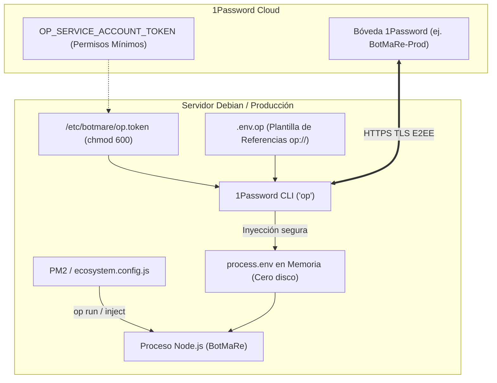

# 🔐 Integración de 1Password Secrets Manager en BotMaRe

Esta guía detalla la arquitectura, configuración, despliegue en producción y procedimientos de seguridad para operar **BotMaRe** utilizando **1Password Secrets Manager** como proveedor de secretos opcional.

---

## 1. Arquitectura y Principios de Diseño



### Reglas DevSecOps Obligatorias:
1. **Sin Dependencias Pesadas:** Se utiliza 1Password CLI oficial (`op`) y su motor de inyección en memoria (`op run` / `op inject`). No se introducen SDKs redundantes en `node_modules`.
2. **Cero Secretos en Disco:** Los secretos reales nunca se escriben en archivos planos cuando 1Password está activo.
3. **Prohibido Fallback Silencioso:** Si 1Password está configurado pero falla (red, token revocado, referencia inexistente), el arranque se aborta con error fatal explícito. **Nunca** cae de forma silenciosa a un `.env` residual con credenciales potencialmente desincronizadas.
4. **Redacción Estricta en Logs:** Todos los mensajes de error, trazas y respuestas de la API o Telegram son sanitizados automáticamente para anonimizar tokens de servicio (`ops_...`) y referencias completas.
5. **Compatibilidad:** `dotenv` (archivo `.env` tradicional) y `environment` (variables de entorno en contenedores/CI) siguen disponibles como proveedores 100% funcionales.

---

## 2. Configuración Rápida Interactiva

BotMaRe incluye un asistente interactivo para configurar el proveedor de secretos sin tocar comandos complejos.

### Desde el Menú Principal:
```bash
pnpm run menu
# Selecciona la opción [19] 🔐 Proveedor Secretos (1Password / .env)
```

### O directamente con el comando dedicado:
```bash
pnpm run setup:provider
```

El asistente:
1. Detecta tu sistema operativo (Debian, Ubuntu, Windows, macOS, Termux).
2. Verifica si `op` CLI está instalado y ofrece instrucciones oficiales si falta.
3. Solicita el nombre de tu bóveda en 1Password (por defecto `BotMaRe-Prod`).
4. Genera la plantilla de referencias en `.env.op`.
5. Ejecuta una prueba de resolución en seco (dry-run) sin imprimir secretos en pantalla.
6. Permite conmutar o revertir entre `1password`, `dotenv` y `environment` en cualquier momento.

---

## 3. Despliegue en Producción (Debian / PM2)

En servidores dedicados o VPS Debian sin interfaz gráfica (headless), 1Password opera mediante una **Cuenta de Servicio (Service Account)**.

### Paso 1: Crear la Cuenta de Servicio en 1Password
1. En tu consola web de 1Password, ve a **Developer** -> **Service Accounts**.
2. Crea una Service Account llamada `botmare-production`.
3. Asigna **permisos de solo lectura** exclusivamente sobre la bóveda dedicada (ej. `BotMaRe-Prod`).
4. Guarda el token generado (`ops_...`).

### Paso 2: Almacenar el Token de Forma Segura en Debian
En el servidor Debian, guarda el token en una ruta protegida con permisos `chmod 600`:

```bash
sudo mkdir -p /etc/botmare
echo -n "ops_tu_token_aqui" | sudo tee /etc/botmare/op.token > /dev/null
sudo chmod 600 /etc/botmare/op.token
sudo chown -R $USER:$USER /etc/botmare
```

*`ecosystem.config.js` detecta automáticamente este archivo al arrancar el proceso de PM2 o tras reinicios del sistema operativo.*

### Paso 3: Plantilla `.env.op`
Crea el archivo `.env.op` en la raíz de BotMaRe con tus referencias:

```ini
# ── AUTENTICACIÓN Y SEGURIDAD ──
DASHBOARD_USER=admin
DASHBOARD_PASS=op://BotMaRe-Prod/botmare-dashboard/password
SUPERADMIN_KEY=op://BotMaRe-Prod/botmare-security/superadmin_key
WEBHOOK_API_KEY=op://BotMaRe-Prod/botmare-security/webhook_key
BACKUP_ENCRYPTION_KEY=op://BotMaRe-Prod/botmare-security/backup_key

# ── PROVEEDORES DE IA ──
GROQ_API_KEY=op://BotMaRe-Prod/botmare-ai/groq_api_key
GEMINI_API_KEY=op://BotMaRe-Prod/botmare-ai/gemini_api_key

# ── TELEGRAM (Opcional) ──
TELEGRAM_BOT_TOKEN=op://BotMaRe-Prod/botmare-telegram/token
TELEGRAM_ALLOWED_USER_IDS=123456789
```

### Paso 4: Activar e Iniciar con PM2
```bash
# Activar 1Password como proveedor
export BOTMARE_SECRET_PROVIDER=1password

# Iniciar o reiniciar con PM2
pnpm run pm2:start

# Comprobar logs limpios
pnpm run pm2:logs
```

---

## 4. Control y Diagnóstico Remoto desde Telegram

Si tienes habilitado el Bot de Telegram, los administradores autorizados tienen acceso a herramientas en tiempo real:

1. **Botón en `/start`:**
   Toca el botón **`🔐 Secretos / 1P`** en el menú principal.
2. **Comando Rápido:**
   Envía `/secretos` en el chat privado con tu bot.
3. **Acciones Disponibles:**
   - **`🔄 Probar Conexión`:** Realiza un health-check contra la bóveda de 1Password y verifica la resolución de las 5 claves obligatorias.
   - **`📊 Ver Variables`:** Muestra la lista de variables mapeadas y su origen (`1Password`, `Entorno`), sin exponer sus valores.
4. **Comando `/informe`:**
   La sección *Seguridad y Secretos* muestra el estado en vivo del proveedor activo.

---

## 5. Rotación y Revocación de Credenciales

* **Rotación en Caliente:** Para cambiar una contraseña o API key, actualiza el valor en tu bóveda de 1Password. En tu próximo reinicio del bot (`pnpm run pm2:restart` o botón en Telegram), el nuevo secreto se inyectará automáticamente en memoria.
* **Revocación de Emergencia:** Si una credencial se compromete, bórrala o invalídala directamente en la consola web de 1Password.

---

## 6. Procedimiento de Reversión (Rollback a .env Local)

Si por cualquier motivo de contingencia de red requieres volver al método clásico con archivo `.env`:

1. Mediante el Asistente:
   ```bash
   pnpm run setup:provider
   # Elige la opción [1] Archivo Local (.env tradicional con dotenv)
   ```
2. O manualmente en una sola línea:
   ```bash
   export BOTMARE_SECRET_PROVIDER=dotenv
   pnpm run pm2:restart
   ```
El sistema volverá a leer exclusivamente tu archivo `.env` local sin interrupciones.

